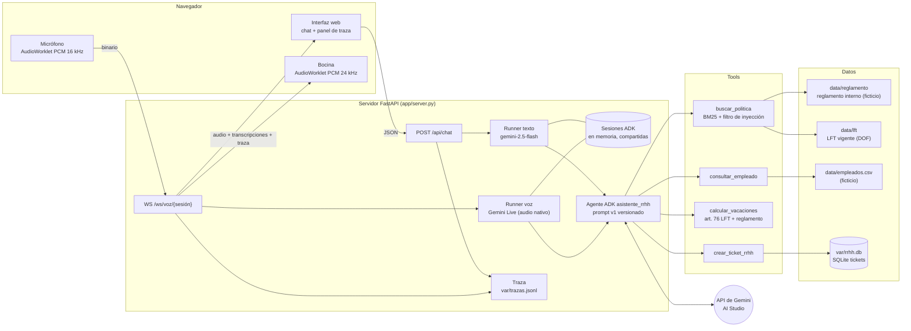

# Arquitectura

## Flujo de una pregunta

1. El empleado escribe o habla. El texto llega a `/api/chat`; el audio llega en bloques de 100 ms al WebSocket, que lo mete en la `LiveRequestQueue` de ADK.
2. El runner pasa el mensaje y el historial de la sesión al modelo con el prompt v1 y el esquema de las cuatro tools.
3. El modelo decide qué tools llamar. `buscar_politica` devuelve artículos completos con su fuente, ya filtrados contra instrucciones inyectadas, y un aviso de que son datos.
4. El modelo responde citando las fuentes. En texto, el servidor devuelve la respuesta con la traza (tools, argumentos, fuentes, latencia y tokens). En voz, manda audio, transcripciones y los mismos eventos de traza por el WebSocket.
5. Si no hay información o el caso requiere a una persona, el agente crea un ticket en SQLite y le da el folio al empleado.

## Decisiones

Ver `docs/adr/`: framework y modelo (0001), RAG léxico (0002), voz nativa (0003), defensa contra inyección (0004), sesiones y tickets (0005).

## Componentes y archivos

| Componente | Archivo |
|---|---|
| Agente y prompt | `app/agent.py`, `prompts/agente_rrhh.v1.md` |
| Búsqueda | `app/rag.py` |
| Filtro de inyección | `app/seguridad.py` |
| Tools | `app/tools/` |
| API y voz | `app/server.py` |
| Traza | `app/traza.py` |
| Interfaz | `app/static/` |
